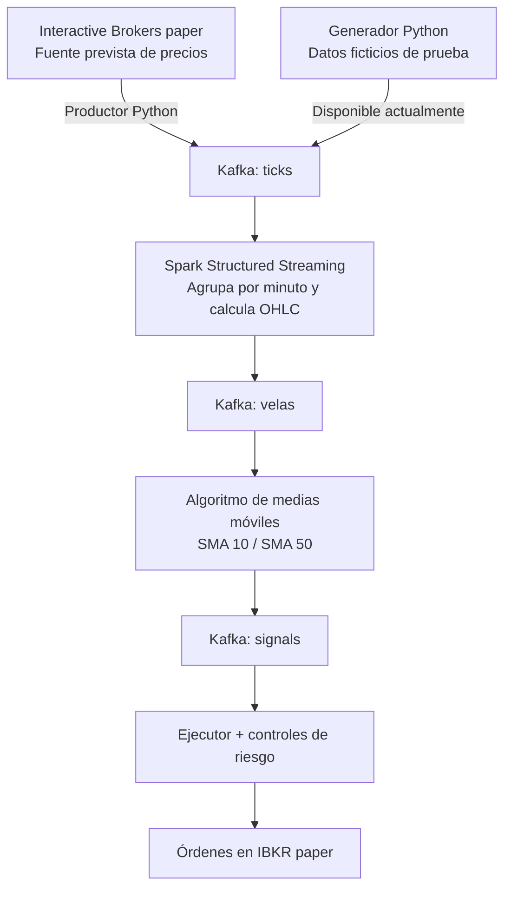

# Proyecto de Trading Algorítmico

**Proyecto escolar | Licenciatura en Inteligencia Artificial y Ciencia de Datos**  
**Equipo:** 6 estudiantes  
**Corte documentado:** 21 de noviembre de 2026  
**Estado:** En desarrollo; infraestructura Kafka y lectura desde Spark comprobadas con datos ficticios.

> **Aviso:** Este proyecto es educativo. En esta etapa no recibe cotizaciones reales ni envía órdenes a Interactive Brokers. Las operaciones previstas serán exclusivamente en una cuenta **paper** (simulada), nunca con dinero real.

## 1. ¿Qué queremos construir?

Un sistema de *trading algorítmico*: programas que reciben precios de un activo financiero, los procesan y aplican reglas matemáticas para producir señales de compra o venta.

El profesor solicita:

1. **Interactive Brokers (IBKR) en modo demo/paper** como fuente de cotizaciones de FOREX, preferentemente **EURUSD** o **GBPUSD**.
2. **Apache Kafka** como medio para intercambiar eventos de precios.
3. **Apache Spark Structured Streaming** para convertir cotizaciones (*ticks*) en velas de **un minuto**.
4. Uno o varios algoritmos que lean ticks o velas y publiquen señales **BUY/SELL**.
5. Un programa ejecutor que revise los riesgos y envíe las órdenes **solo a la cuenta paper**.
6. **Opcional/deseable:** *backtesting* (evaluar una estrategia usando datos históricos).

El profesor también exige **formatos comunes de eventos** para que los algoritmos de un equipo puedan ejecutarse sobre la plataforma de otro.

**Elección inicial del equipo (propuesta, no exigencia adicional del profesor):** desarrollar primero una estrategia de medias móviles simples de 10 y 50 velas para **EURUSD**. El pseudocódigo del profesor usa BTC/USDT, que habrá que adaptar a FOREX.

## 2. ¿Cómo viaja la información?



**Conceptos clave:**

- **Tick:** un mensaje que contiene una cotización, incluidos precios `bid` (precio al que el bróker compra) y `ask` (precio al que vende).
- **Tópico:** canal de Kafka que almacena mensajes de un tipo, como `ticks`.
- **Productor:** programa que envía mensajes a Kafka. **Consumidor:** programa que los lee.
- **Streaming:** procesamiento de datos que llegan de forma continua.
- **Vela OHLC:** resumen de precios de un periodo: **O**pen/apertura, **H**igh/máximo, **L**ow/mínimo y **C**lose/cierre.
- **SMA (media móvil simple):** promedio de los cierres de las últimas N velas.
- **Stop Loss:** regla de salida para limitar una pérdida. **Take Profit:** regla de salida al alcanzar un objetivo de ganancia.

## 3. Avance real al 21/11/2026

| Componente o prueba | Estado | Evidencia comprobada |
|---|---|---|
| Windows 11, Python y entorno virtual `.venv` | ✅ Verificado | Python 3.11.9 activo |
| Docker Desktop + WSL 2 | ✅ Verificado | `hello-world` exitoso |
| Kafka 4.4.0 en Docker | ✅ Verificado | Contenedor `kafka-trading` activo y `cluster-id` obtenido |
| Tópicos `ticks`, `velas`, `signals` | ✅ Creados | `kafka-topics.sh --list` mostró los tres |
| Envío de un mensaje manual a `ticks` | ✅ Probado | Mensaje JSON recibido por consumidor |
| Productor Python de datos ficticios | ✅ Probado | Dos ejecuciones de 5 cotizaciones cada una |
| Spark 4.2.1 en Docker | ✅ Verificado | `spark-submit --version` correcto |
| Conectividad TCP Spark → Kafka | ✅ Verificada | Conexión al puerto 9092 exitosa |
| Lectura Spark Structured Streaming desde `ticks` | ✅ Probada | Spark mostró 11 mensajes en consola |
| Conversión de ticks a velas de un minuto | ⏳ Pendiente | Próximo desarrollo: paso 15 |
| Publicación de velas en Kafka | ⏳ Pendiente | Tópico `velas` ya existe, pero no se han publicado velas |
| Algoritmo SMA 10/50 y `signals` | ⏳ Pendiente | Sin señales generadas aún |
| Ejecutor con controles de riesgo | ⏳ Pendiente | Sin órdenes enviadas |
| IBKR cuenta paper / API / cotizaciones | ⏳ Bloqueado | Cuenta creada; verificación todavía pendiente |
| Backtesting | ◇ Opcional | No iniciado |

**Resultado clave de la última prueba:** se recibieron **11 mensajes de prueba**: 1 manual y 10 generados por Python. La lectura con Spark funcionó tras configurar una carpeta temporal válida para Apache Ivy (`spark.jars.ivy=/tmp/spark-ivy`).

## 4. Estructura del proyecto

```text
Proyecto_Trading_Algoritmico/
├── .venv/                    # Entorno local de Python: NO subir a Git
├── venv/                     # Segundo entorno detectado: NO subir a Git
├── src/
│   ├── productor_ticks.py    # Generador Python de ticks ficticios (ya probado)
│   └── leer_ticks_spark.py   # Lector de Kafka con Spark (ya probado)
├── config/                   # Configuraciones; pendiente de desarrollar
├── datos_prueba/             # Datos sintéticos para pruebas
├── tests/                    # Pruebas automatizadas futuras
├── evidencias/               # Capturas sin datos privados
├── docs/
│   ├── REQUERIMIENTOS_TECNICOS.md
│   ├── INSTALACION_PASO_A_PASO.md
│   └── MAPA_DE_TRABAJO.md
├── requirements.txt         # Dependencia Python verificada a nivel de librería
├── .gitignore
└── README.md
```

> Los archivos de `src` están en la computadora donde trabaja el equipo y **no se incluyen en el paquete de documentación**. Deben conservarse y agregarse al mismo repositorio al hacer el commit. Git no rastrea carpetas vacías; se incluyen archivos `.gitkeep` para conservar la estructura.

## 5. Instalación y preparación para un integrante nuevo

**Se trabaja con una sola computadora ejecutora; los otros cinco integrantes siguen la sesión, observan los resultados y documentan las decisiones.**

**¿Vas a preparar una computadora por primera vez?** Comienza aquí: **[INSTALACIÓN PASO A PASO (Windows 11)](docs/INSTALACION_PASO_A_PASO.md)**. Incluye descargas oficiales, órdenes exactas en PowerShell, resultados esperados, resolución de errores y qué no se debe reinstalar. No es necesario instalar todo para seguir la sesión por pantalla.

**¿Vas a continuar en la computadora de María?** Usa la [Sección B de la guía de instalación](docs/INSTALACION_PASO_A_PASO.md#b-continuar-en-la-computadora-que-ya-funciona); no clones ni recrees contenedores que ya existen.


1. Leer este `README.md` y el [mapa de trabajo](docs/MAPA_DE_TRABAJO.md).
2. Revisar los [requerimientos técnicos](docs/REQUERIMIENTOS_TECNICOS.md).
3. Abrir la carpeta local del proyecto en Visual Studio Code (VS Code).
4. Abrir PowerShell en la raíz del proyecto y activar el entorno: `.\.venv\Scripts\Activate.ps1` (si `.venv` existe; para una computadora nueva ver guía de instalación).
5. Comprobar Docker y Kafka: `docker ps` y `docker exec kafka-trading /opt/kafka/bin/kafka-topics.sh --list --bootstrap-server localhost:9092`.
6. Para probar el generador de ticks (con Kafka encendido): `python src/productor_ticks.py`.
7. Para repetir la lectura con Spark, usar el comando reproducible del documento de requerimientos.

**Nota:** La ruta `C:\Users\maria\Desktop\Proyecto_Trading_Algoritmico` corresponde a la computadora ejecutora actual. En otra computadora será distinta.

## 6. Formatos oficiales de eventos

Los nombres de campo y de tópico son los especificados por el profesor. Los valores siguientes son únicamente ejemplos ficticios; para las fechas se propone ISO 8601 en UTC.

**Tópico `ticks`:**

```json
{"symbol":"EURUSD","bid":1.0850,"ask":1.0852,"timestamp":"2026-11-21T17:51:18Z"}
```

**Tópico `velas` (todavía no implementado):**

```json
{"symbol":"EURUSD","inicio":"2026-11-21T17:51:00Z","open":1.0851,"high":1.0855,"low":1.0851,"close":1.0855,"num_ticks":5}
```

**Tópico `signals` (todavía no implementado):**

```json
{"id_algoritmo":"SMA_10_50","symbol":"EURUSD","signal":"BUY","precio_referencia":1.0855,"timestamp":"2026-11-21T17:52:00Z"}
```

**Decisión por confirmar:** usar el precio medio `mid = (bid + ask) / 2` para construir las velas. El profesor especificó los campos, pero no qué precio se debe usar para el OHLC. Esto afecta el cálculo de señales; las órdenes reales de paper trading deben considerar precios bid/ask, spread y comisiones.

## 7. Estrategia propuesta

Partimos del pseudocódigo **Trading_Cruce_Medias_Moviles** entregado por el profesor:

- **SMA corta:** 10 velas. **SMA larga:** 50 velas.
- **Comprar:** cuando SMA corta sea mayor que SMA larga y no haya una posición abierta.
- **Cerrar la posición:** por Stop Loss (2 % de variación adversa del precio), Take Profit (4 % de variación favorable) o cuando SMA corta sea menor que SMA larga.
- **Capital por operación:** el pseudocódigo usa `1000`, sin precisar su aplicación a FOREX; tamaño y divisa deben definirse antes de operar.

**Precisión:** comparar `SMA_corta > SMA_larga` no equivale a detectar el instante exacto de un cruce. El primer desarrollo seguirá la lógica proporcionada y documentará cualquier ajuste. Un Stop Loss del 2 % en precio **no** equivale necesariamente a arriesgar el 2 % del capital de la cuenta.

## 8. Qué sigue

El siguiente paso es **implementar un job de Spark Structured Streaming** que lea JSON de `ticks`, agrupe por minuto según el tiempo del evento, calcule OHLC y publique cada vela terminada en `velas`. Después se desarrollarán las señales, el ejecutor paper y la integración con IBKR cuando la verificación de la cuenta lo permita.

El plan detallado, las tareas y los criterios de terminación están en [MAPA_DE_TRABAJO.md](docs/MAPA_DE_TRABAJO.md).

## 9. Fuentes del proyecto

Material proporcionado por el profesor:

- `Indicaciones proyecto.txt` — requisitos obligatorios y esquemas de mensajes.
- `Introducción al Trading Algoritmico - Google Slides.pdf` — conceptos de trading, FOREX, velas OHLC, indicadores, riesgo y costos.
- `pseudocodigo-trading.pdf` — estrategia base SMA 10/50 y reglas de salida.

Documentación externa de referencia: [API TWS de Interactive Brokers](https://interactivebrokers.github.io/tws-api/), [Apache Kafka](https://kafka.apache.org/documentation/) y [Spark Structured Streaming](https://spark.apache.org/docs/latest/streaming/index.html).

> **Trabajo en equipo:** una persona ejecuta y comparte pantalla; cinco integrantes verifican, preguntan, registran decisiones y guardan evidencias. El objetivo es que cualquiera de los seis pueda explicar cada componente.
