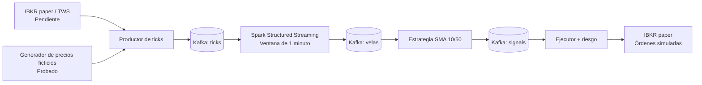

# Diseño del sistema, mapa de trabajo y estado del proyecto

**Corte:** 21/11/2026  
**Fase actual:** integración básica de Kafka y Spark comprobada. **Siguiente actividad: generar velas OHLC de un minuto.**

**Guía para que otro integrante reproduzca las pruebas:** [INSTALACION_PASO_A_PASO.md](INSTALACION_PASO_A_PASO.md) (separa equipos nuevos y computadora ya configurada).

## 1. Arquitectura objetivo

El sistema se divide en **componentes** (programas con una responsabilidad) para que distintos equipos puedan intercambiar algoritmos sin modificar el resto de la infraestructura.

### Diseño de cada componente

| Componente | Entrada | Trabajo | Salida |
|---|---|---|---|
| Productor | Precios ficticios; después IBKR | Convierte cada cotización al esquema del profesor | `ticks` |
| Kafka `ticks` | Eventos JSON de cotización | Los conserva y distribuye a consumidores | Mensajes para Spark |
| Spark Structured Streaming | `ticks` | Calcula velas de 1 minuto mediante ventana por tiempo de evento | `velas` |
| Estrategia SMA | Velas completas | Calcula medias de 10/50, evalúa posición y produce señales | `signals` |
| Ejecutor | `signals` | Valida riesgos, estado de posiciones y ausencia de duplicados | Órdenes paper en IBKR |

## 2. Registro de avance con evidencias

**Completado y comprobado durante la sesión del equipo:**

| # | Paso | Evidencia |
|---|---|---|
| 1 | Preparación Windows 11, Python 3.11.9, VS Code y Git | Comandos de versión correctos |
| 2 | Docker Desktop + WSL 2 | `docker info` informó cliente/servidor; `hello-world` funcionó |
| 3 | Memoria disponible | Windows ~8 GB; Docker 3.673 GiB |
| 4 | Carpeta `Proyecto_Trading_Algoritmico` y estructura `src`, `config`, `datos_prueba`, `tests`, `evidencias` | Carpetas creadas en VS Code/PowerShell |
| 5 | Entorno virtual `.venv` | `(.venv)` y Python 3.11.9 |
| 6 | Archivo `.gitignore` | `Test-Path .gitignore` devolvió `True`; revisar que ignore `.env` sin barra |
| 7 | Kafka `apache/kafka:4.4.0` | Contenedor `kafka-trading` arriba y cluster ID retornado |
| 8 | Tópicos `ticks`, `velas`, `signals` | Los tres listados correctamente |
| 9 | Productor y consumidor manuales | Mensaje JSON recibido en `ticks` |
| 10 | `src/productor_ticks.py` | Cinco cotizaciones por ejecución; dos ejecuciones mostradas |
| 11 | Spark 4.2.1 | `spark-submit --version` mostró versión correcta |
| 12 | Conexión de red Spark → Kafka | Prueba TCP al puerto 9092 exitosa |
| 13 | `src/leer_ticks_spark.py` | Tabla de Spark con **11 cotizaciones** |

**Aclaración:** Las pruebas anteriores usan **precios ficticios**. La lectura de Spark es un prototipo y todavía no constituye el job completo exigido por el profesor. El repositorio GitHub fue creado, pero no estaba cargado al consultar su dirección para este corte.

## 3. Próximos pasos: acción, motivo, recursos y criterio de aceptación

### Paso 15 — Spark: generar velas OHLC (obligatorio)

- **Acción:** leer JSON de `ticks`; convertir fecha/hora y valores numéricos; agrupar por símbolo y minuto; obtener `open`, `high`, `low`, `close` y `num_ticks`; publicar velas terminadas en `velas`.
- **Por qué:** el algoritmo trabaja con cierres de velas, no con mensajes individuales.
- **Necesitamos:** Spark Structured Streaming, Kafka, conector Spark–Kafka, una fuente temporal de ticks suficientemente variada, definición del precio a resumir (`mid` propuesto).
- **Termina cuando:** el consumidor de `velas` muestra objetos JSON con exactamente los campos definidos por el profesor y se verifica manualmente un ejemplo conocido.
- **Puntos de atención:** usar **tiempo del evento**, no el de procesamiento; asegurar orden correcto para apertura/cierre; evitar emitir varias veces velas incompletas. Definir manejo de eventos tardíos y checkpoint (registro del progreso del streaming).

### Paso 16 — Validar generación de datos de prueba (propuesto)

- **Acción:** crear secuencias de ticks ficticios reproducibles, suficientes para varias velas; conservarlas en `datos_prueba` o en un generador dedicado.
- **Por qué:** con solo cinco ticks por ejecución no se puede validar una estrategia de 50 velas.
- **Necesitamos:** Python, timestamps de prueba y casos controlados con resultados esperados.
- **Termina cuando:** se calculan velas conocidas y se detectan errores en marcas de tiempo o precios.

### Paso 17 — Estrategia SMA 10/50 (obligatorio: un algoritmo)

- **Acción:** consumir `velas`, mantener las últimas 50 velas completas y comparar las SMA de 10 y 50; publicar BUY/SELL en `signals`.
- **Por qué:** implementa el pseudocódigo del profesor adaptándolo de BTC/USDT a EURUSD.
- **Necesitamos:** Python, media simple, estado de posición y formato de mensaje `signals`.
- **Termina cuando:** casos de prueba controlados generan señales justificadas y no se emiten compras repetidas por cada vela.
- **Puntos de atención:** el pseudocódigo compara medias; no detecta estrictamente el **momento del cruce**. Documentar cómo se decidió implementarlo.

### Paso 18 — Ejecutor y gestión de riesgo sin órdenes reales (obligatorio)

- **Acción:** consumir `signals`, validar símbolo permitido, cuenta paper, tamaño de operación, duplicados, posición abierta, Stop Loss y Take Profit; primero registrar decisiones sin enviar órdenes.
- **Por qué:** separar la señal de la autorización de operar reduce errores y riesgos.
- **Necesitamos:** reglas de riesgo acordadas y mecanismo de seguimiento del estado.
- **Termina cuando:** un conjunto de señales válidas e inválidas se acepta o rechaza correctamente, con motivo registrado.
- **Puntos de atención:** `stop_loss_pct=0.02` en el pseudocódigo es una variación porcentual del precio, **no equivale automáticamente al 2 % del capital total arriesgado**. Considerar spread, comisiones, tamaños de contratos y órdenes rechazadas.

### Paso 19 — Integración con Interactive Brokers paper (obligatorio; bloqueado)

- **Acción:** al completarse la verificación, configurar TWS/IB Gateway y su API, comprobar permisos para cotizaciones de EURUSD y recepción de órdenes; sustituir el productor simulado por un productor conectado a IBKR; ejecutar pruebas **solo en paper**.
- **Por qué:** el profesor exige la fuente y el destino de operaciones en IBKR demo/paper.
- **Necesitamos:** cuenta habilitada, permisos de datos, API y conexión segura.
- **Termina cuando:** se confirma el flujo IBKR → `ticks` y el ejecutor obtiene el estado de una orden paper autorizada.
- **Bloqueo actual:** cuenta creada, pero verificación pendiente; no suponer que la cuenta tiene todos los permisos.

### Paso 20 — Pruebas integradas y resistencia a fallos (obligatorio para validar el sistema)

- **Acción:** seguir una cotización de origen a destino; probar mensajes malformados, reconexiones, duplicados, interrupciones y reinicio de servicios.
- **Por qué:** cada parte puede funcionar por separado y fallar al integrarse.
- **Necesitamos:** registros (logs), ejemplos de entrada/salida, capturas y criterios de aceptación.
- **Termina cuando:** hay una demostración completa reproducible y una lista de incidencias resueltas o pendientes.

### Paso 21 — Backtesting (deseable, no obligatorio)

- **Acción:** reproducir precios históricos y estimar los resultados de la estrategia.
- **Por qué:** comparar decisiones con resultados anteriores sin arriesgar dinero.
- **Necesitamos:** precios históricos confiables, reglas reproducibles, spread/comisiones y métricas de rendimiento.
- **Termina cuando:** existe un reporte de operaciones y métricas con limitaciones explicadas.

### Paso 22 — Documentación y exposición final (necesario para el equipo)

- **Acción:** actualizar este mapa, incluir código, capturas, fallos, versiones, explicación de cada componente y una demostración de extremo a extremo.
- **Por qué:** los seis integrantes deben comprender y poder explicar la solución.
- **Necesitamos:** repositorio GitHub y bitácora de pruebas.
- **Termina cuando:** otro integrante puede explicar `ticks → velas → signals → ejecutor` y reproducir la prueba sin depender de quien escribió el código.

## 4. Decisiones abiertas que hay que registrar antes de implementarlas

| Decisión | Situación actual |
|---|---|
| Par FOREX | **EURUSD** elegido de forma provisional; GBPUSD también permitido por el profesor |
| Fuente de precio para OHLC | `mid=(bid+ask)/2` propuesto; no definido en indicaciones |
| Timestamp | UTC en formato ISO 8601 propuesto para interoperabilidad |
| Detectar cruce exacto o comparar medias | Pseudocódigo compara `SMA10 > SMA50`; mantenerlo inicialmente y documentar |
| Semilla de datos para 50 velas | Pendiente de fuente/generador reproducible |
| Riesgo por operación | Stop Loss 2 % y Take Profit 4 % aparecen en pseudocódigo; falta precisar tamaño de posición y riesgo monetario |
| Red Docker | Spark comparte temporalmente red con Kafka; no es diseño final |
| Estado de IBKR | Cuenta paper creada, verificación pendiente |
| Entrega solicitada por el profesor | No indicó explícitamente si exige PDF, video, informe o exposición; confirmar |

## 5. Dinámica de seis integrantes

Una persona ejecuta el proyecto y comparte pantalla. Las otras cinco siguen **el mismo avance**: verifican resultados, registran comandos, capturan evidencias, hacen preguntas de comprensión y pueden explicar el recorrido del dato.

**Pausas recomendadas:**

1. Tras la lectura de Kafka con Spark: ¿qué diferencia hay entre tópico, productor, consumidor y Spark?
2. Tras crear velas: ¿de dónde salen `open`, `high`, `low`, `close` y `num_ticks`?
3. Tras implementar medias: ¿por qué se requieren 50 velas y cuándo se produce BUY/SELL?
4. Tras el ejecutor: ¿quién decide y quién autoriza una orden? ¿Qué pasa con un duplicado?
5. Tras IBKR paper: ¿qué evidencia demuestra que no estamos operando con dinero real?

**Bitácora mínima por avance:** fecha, objetivo, comando o archivo modificado, resultado esperado, resultado obtenido, error si lo hubo, solución, captura y persona que explicó el concepto al equipo.

## 6. Definición de este primer corte para GitHub

Debe incluir:

- [x] `README.md` comprensible para integrantes nuevos.
- [x] `docs/REQUERIMIENTOS_TECNICOS.md` con entorno comprobado.
- [x] `docs/INSTALACION_PASO_A_PASO.md` con instrucciones desde cero para Windows 11.
- [x] `docs/MAPA_DE_TRABAJO.md` con estado y pendientes.
- [x] `.gitignore` para excluir entornos y secretos (revisar archivo local antes del commit).
- [ ] `src/productor_ticks.py` y `src/leer_ticks_spark.py` agregados desde **la computadora ejecutora**, ya que no se incluyeron en el paquete documental.
- [ ] Revisar `git status`, crear el commit y confirmar que GitHub muestre los archivos.

**No marcar como entregado:** velas OHLC, señales, ejecutor, operaciones IBKR o backtesting; todavía no están implementados.
