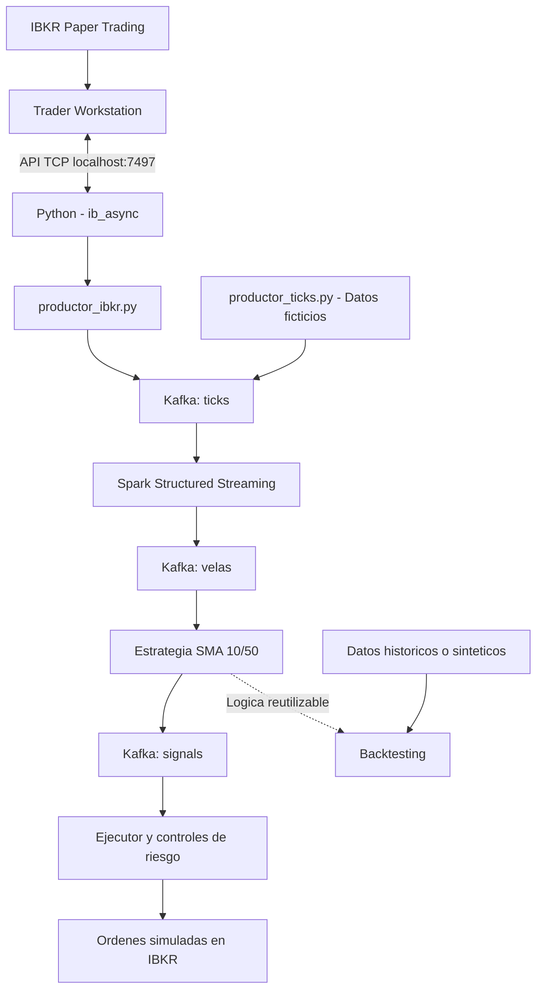

# Diseño del sistema, mapa de trabajo y estado del proyecto

**Proyecto:** Trading Algorítmico
**Programa:** Licenciatura en Inteligencia Artificial y Ciencia de Datos
**Equipo:** 6 estudiantes
**Corte:** 26/11/2026
**Versión documental:** 1.2
**Fase actual:** Desarrollo e integración de componentes.

## 1. Objetivo del mapa de trabajo

Registrar el diseño del sistema, las actividades realizadas, las evidencias obtenidas, las decisiones técnicas y los criterios de aceptación de cada componente.

El propósito no es únicamente desarrollar un sistema funcional, sino garantizar que los seis integrantes comprendan qué se está haciendo, cómo, dónde y por qué.

### 1.1. Documentación complementaria

- [README principal](../../README.md)
- [Instalación paso a paso](INSTALACION_PASO_A_PASO.md)
- [Requerimientos técnicos](REQUERIMIENTOS_TECNICOS.md)
- [Estrategia SMA 10/50 y backtesting](GUIA_ESTRATEGIA_Y_BACKTESTING.md)
- [Integración de la API de Interactive Brokers](../INTEGRACION_API_IBKR.md)

---

## 2. Arquitectura objetivo



El sistema se divide en componentes independientes para facilitar su desarrollo, mantenimiento, validación e interoperabilidad con los algoritmos de otros equipos.

### 2.1. Diseño de los componentes

| Componente | Entrada | Procesamiento | Salida |
|---|---|---|---|
| TWS API | Datos de IBKR | Comunicación con Python mediante sockets | Cotizaciones |
| Productor IBKR | Cotizaciones EURUSD | Validación y serialización JSON | ticks |
| Productor ficticio | Precios sintéticos | Generación de eventos de prueba | ticks |
| Kafka ticks | Eventos JSON | Almacenamiento y distribución | Mensajes para Spark |
| Spark | Cotizaciones | Agrupación temporal y cálculo OHLC | velas |
| Estrategia SMA | Velas completas | Cálculo de medias y evaluación de posición | signals |
| Ejecutor | Señales BUY/SELL | Validación de riesgos y posiciones | Órdenes paper |
| Backtesting | Datos históricos o sintéticos | Simulación de la estrategia | Métricas y reportes |

### 2.2. Principios de diseño

- Separación de responsabilidades.
- Independencia entre componentes.
- Reutilización de la lógica de la estrategia.
- Compatibilidad con los formatos definidos por el profesor.
- Reproducibilidad de las pruebas.
- Trazabilidad de las decisiones.
- Seguridad de las conexiones.
- Operaciones exclusivamente simuladas.
- Validación individual antes de la integración.

---

## 3. Registro histórico de avances

### 3.1. Infraestructura comprobada al 21/11/2026

Las siguientes actividades corresponden a la computadora ejecutora utilizada durante la configuración inicial del equipo.

| Paso | Actividad | Evidencia |
|---|---|---|
| 1 | Preparación de Windows 11, Python 3.11.9, VS Code y Git | Comandos de versión correctos |
| 2 | Docker Desktop y WSL 2 | docker info y hello-world exitosos |
| 3 | Verificación de memoria | Windows aproximadamente 8 GB; Docker 3.673 GiB |
| 4 | Creación de estructura del proyecto | Carpetas creadas |
| 5 | Entorno virtual .venv | Activación correcta |
| 6 | Archivo .gitignore | Existencia comprobada |
| 7 | Kafka 4.4.0 | Contenedor kafka-trading y cluster ID |
| 8 | Tópicos ticks, velas y signals | Listado correcto |
| 9 | Productor y consumidor manuales | Mensaje JSON recibido |
| 10 | Productor Python ficticio | Dos ejecuciones de cinco cotizaciones |
| 11 | Spark 4.2.1 | Comando de versión correcto |
| 12 | Conectividad Spark-Kafka | Conexión TCP al puerto 9092 |
| 13 | Lectura de ticks mediante Spark | Once mensajes recibidos |

### 3.2. Resultado de la primera integración

Se recibieron once mensajes:

- Un mensaje generado manualmente.
- Diez cotizaciones generadas mediante Python.

La lectura con Spark funcionó después de configurar una carpeta temporal válida para Apache Ivy:

    spark.jars.ivy=/tmp/spark-ivy

Estas pruebas utilizaron datos ficticios.

No constituyen una validación de la generación de velas OHLC ni del sistema completo.

### 3.3. Avances de estrategia y backtesting

**Responsable:** Laura M. Sánchez Martínez.

Desarrollo incorporado al repositorio antes del corte del 24/11/2026.

| Archivo | Actividad |
|---|---|
| src/estrategia_sma.py | Implementación de la estrategia SMA 10/50 |
| src/estrategia_kafka.py | Adaptador de la estrategia para Kafka |
| src/generar_velas_prueba.py | Generación de velas sintéticas reproducibles |
| src/descargar_datos.py | Obtención de datos históricos |
| src/backtesting.py | Simulación de la estrategia |
| tests/test_estrategia_sma.py | Pruebas automatizadas |
| datos_prueba/velas_sinteticas.csv | Datos sintéticos |
| resultados/ | Reportes, operaciones y gráficas |

La documentación de la responsable registra diez pruebas automáticas y resultados de backtesting.

No se volvieron a ejecutar estas pruebas durante la actualización documental del 24/11/2026.

### 3.4. Avances de Interactive Brokers al 24/11/2026

Las siguientes actividades se realizaron en una computadora Windows distinta de la configuración inicial de Docker.

| Actividad | Resultado |
|---|---|
| Descarga de Trader Workstation | Completada |
| Instalación de TWS | Completada |
| Inicio de sesión Paper Trading | Verificado |
| Configuración de API mediante sockets | Verificada |
| Conexión TCP localhost:7497 | Exitosa |
| Instalación de ib_async 2.1.0 | Verificada |
| Comunicación mediante TWS API | Exitosa |
| Solicitud de cotizaciones EURUSD | Exitosa |
| Recepción continua durante 30 segundos | Verificada |
| Actualización de requirements.txt | Realizada |
| Creación de src/productor_ibkr.py | Realizada |
| Validación de sintaxis del productor | Aprobada |
| Publicación de cotizaciones IBKR en Kafka | Pendiente |
| Integración con Spark | Pendiente |
| Envío de órdenes paper | No realizado |

La conexión con IBKR se realizó sin Docker.

La computadora utilizada para estas pruebas no contaba con Docker instalado y no se verificó la disponibilidad de un servicio Kafka local.

### 3.5. Evidencias principales de IBKR

Prueba TCP:

    Conexion TCP exitosa con TWS

Prueba de comunicación API:

    API IBKR conectada: True

Cotización recibida:

    EURUSD | BID: 1.09664 | ASK: 1.09666 | Tipo de datos: 1

Validación de sintaxis:

```bash
python -m py_compile src/productor_ibkr.py
```

El comando finalizó sin errores de sintaxis.

No se realizó una medición independiente de latencia ni una auditoría completa de los permisos de datos financieros.

El procedimiento completo se encuentra en:

[INTEGRACION_API_IBKR.md](../INTEGRACION_API_IBKR.md)

---

## 4. Estado consolidado de actividades

Se conserva la numeración original del mapa de trabajo.

| Paso | Actividad | Estado |
|---|---|---|
| 1-13 | Infraestructura y lectura inicial de Kafka con Spark | Verificado previamente |
| 15 | Generación de velas OHLC | Implementado; validación integral pendiente |
| 16 | Generación de datos de prueba | Generadores implementados; validación pendiente |
| 17 | Estrategia SMA 10/50 | Implementada; conexión por tópicos principales |
| 18 | Ejecutor y gestión de riesgos | Parcialmente completado; continuar en 18.9 |
| 19 | Integración con Interactive Brokers | Parcialmente completado |
| 20 | Pruebas integradas y resistencia a fallos | Pruebas parciales realizadas |
| 21 | Backtesting | Implementado y documentado |
| 22 | Documentación y exposición | En progreso |

La ausencia del paso 14 corresponde a la numeración del documento original.

No se modifica dicha numeración para mantener la trazabilidad histórica.

---

## 5. Actividades, justificación y criterios de aceptación

### Paso 15 — Spark: generar velas OHLC

**Carácter:** Obligatorio.

**Estado:** Implementado; validación integral pendiente.

**Qué debemos hacer:**

- Leer mensajes JSON desde ticks.
- Convertir los campos a los tipos de datos correspondientes.
- Interpretar las marcas temporales.
- Agrupar por símbolo y ventanas de un minuto.
- Calcular open, high, low, close y num_ticks.
- Publicar las velas terminadas en el tópico velas.

**Por qué:**

La estrategia SMA utiliza los precios de cierre de velas completas, no cotizaciones individuales.

**Dónde:**

En el componente Spark Structured Streaming del proyecto.

**Recursos necesarios:**

- Apache Spark.
- Apache Kafka.
- Conector Spark-Kafka.
- Datos de prueba reproducibles.
- Definición del precio utilizado para construir las velas.

**Criterio de aceptación:**

El consumidor de velas recibe objetos JSON con los campos definidos por el profesor y sus valores coinciden con cálculos manuales de casos conocidos.

**Consideraciones técnicas:**

- Utilizar tiempo del evento cuando esté disponible y correctamente identificado.
- Diferenciar tiempo de origen y tiempo de recepción.
- Determinar el orden correcto de apertura y cierre.
- Evitar publicar velas incompletas como definitivas.
- Definir el manejo de eventos tardíos.
- Configurar checkpoints.
- Determinar si el precio utilizado será MID, BID o ASK.

---

### Paso 16 — Generación y validación de datos de prueba

**Carácter:** Actividad de soporte.

**Estado:** Generadores implementados; validación pendiente.

**Qué se hizo:**

Se implementó un generador de velas sintéticas reproducibles para evaluar la estrategia SMA.

**Dónde:**

    src/generar_velas_prueba.py
    datos_prueba/velas_sinteticas.csv

**Por qué:**

La estrategia requiere al menos 50 velas para calcular ambas medias móviles.

El productor ficticio inicial genera únicamente cinco cotizaciones por ejecución.

**Resultado documentado:**

Se dispone de datos sintéticos para probar la estrategia y el backtesting.

**Qué falta:**

Generar o preparar secuencias controladas de ticks que permitan comprobar la transformación de cotizaciones individuales a velas OHLC.

**Criterio de aceptación:**

- Los datos son reproducibles.
- Los resultados esperados están definidos.
- Se verifican manualmente las velas generadas por Spark.
- Se detectan errores de precio y marcas temporales.

La disponibilidad de velas sintéticas no demuestra que Spark pueda construirlas correctamente desde ticks.

---

### Paso 17 — Estrategia SMA 10/50

**Carácter:** Obligatorio.

**Estado:** Implementada y probada de forma aislada según la documentación de Laura. Conexión por tópicos principales implementada; validación integral pendiente.

**Responsable del desarrollo documentado:** Laura M. Sánchez Martínez.

**Qué se hizo:**

- Implementación de la lógica SMA.
- Separación entre la estrategia y Kafka.
- Cálculo de medias de 10 y 50 cierres.
- Generación de señales BUY y SELL.
- Gestión lógica de posiciones.
- Filtrado de velas duplicadas o anteriores.
- Implementación de pruebas automatizadas.
- Desarrollo del adaptador para Kafka.

**Dónde:**

    src/estrategia_sma.py
    src/estrategia_kafka.py
    tests/test_estrategia_sma.py

**Por qué:**

Implementar el pseudocódigo proporcionado por el profesor y permitir que la estrategia pueda reutilizarse en diferentes plataformas.

**Cómo funciona:**

1. Recibe una vela.
2. Comprueba el símbolo.
3. Descarta velas repetidas o anteriores.
4. Conserva los últimos 50 cierres.
5. Calcula SMA10 y SMA50.
6. Genera BUY cuando corresponde.
7. Genera SELL por Stop Loss, Take Profit o condición bajista.

**Pruebas documentadas:**

Diez pruebas automáticas.

Comando de reproducción:

```bash
python -m unittest discover tests -v
```

**Criterio de aceptación:**

Los casos controlados generan señales justificadas, respetan los formatos del profesor y evitan compras repetidas cuando existe una posición abierta.

**Qué falta:**

- Validar el consumo de velas producidas por Spark.
- Verificar la publicación integrada en signals.
- Comprobar la compatibilidad con el ejecutor.
- Revisar la sincronización entre el estado lógico de la estrategia y las posiciones efectivamente ejecutadas.

**Decisión pendiente:**

Confirmar que SELL significa cerrar una posición de compra y no abrir una posición corta.

---

### Paso 18 — Ejecutor y gestión de riesgos

**Carácter:** Obligatorio.

**Estado:** Parcialmente completado. Continuar en 18.9.

**Qué debemos hacer:**

Desarrollar un componente independiente que consuma señales y determine si pueden convertirse en órdenes simuladas.

**Validaciones previstas:**

- Cuenta Paper Trading.
- Símbolo permitido.
- Tamaño de posición.
- Señales duplicadas.
- Existencia de posiciones abiertas.
- Estado de órdenes anteriores.
- Stop Loss.
- Take Profit.
- Riesgo monetario.
- Disponibilidad y vigencia de los datos.

**Por qué:**

Una señal de la estrategia no debe equivaler automáticamente a una autorización para operar.

Separar ambas responsabilidades permite reducir errores y controlar los riesgos.

**Primera etapa:**

Registrar decisiones de aceptación o rechazo sin enviar órdenes.

**Criterio de aceptación:**

Un conjunto de señales válidas e inválidas se acepta o rechaza correctamente, dejando evidencia de los motivos.

**Restricciones:**

- No utilizar cuentas reales.
- No enviar órdenes durante las pruebas de solo lectura.
- No habilitar permisos de escritura antes de validar los controles.
- No interpretar el puerto 7497 como garantía suficiente de que la sesión es simulada.

**Consideración financiera:**

El Stop Loss del 2 % establecido en el pseudocódigo representa una variación del precio y no equivale necesariamente al 2 % del capital arriesgado.

---

#### Desglose operativo del paso 18 — Corte 26/11/2026

| Subpaso | Actividad | Estado |
|---|---|---|
| 18.1 | Consumidor Kafka | Implementado |
| 18.2 | Validación de señales, símbolo, precio y vigencia | Implementado |
| 18.3 | Control de duplicados y posición lógica | Implementado |
| 18.4 | Persistencia mediante SQLite | Implementado |
| 18.5 | Generadores de señales de prueba | Implementado |
| 18.6 | Consolidación del ejecutor principal | Completado |
| 18.7 | Configuración y cálculo del riesgo monetario | Completado dentro del alcance local |
| 18.8 | Seguridad de conexión IBKR Paper | Validada dentro del alcance local |
| 18.9 | Consulta y sincronización de posiciones y órdenes IBKR | Pendiente |
| 18.10 | Controles de riesgo restantes | Pendiente |
| 18.11 | Validación integral del ejecutor Dry Run | Pendiente |
| 18.12 | Documentación y cierre del ejecutor | En progreso |

#### Archivos principales

- src/ejecutor_riesgo.py: ejecutor principal en modo Dry Run.
- src/config_riesgo.py: parámetros de riesgo.
- src/calculo_riesgo.py: cálculo de exposición y riesgo monetario.
- src/seguridad_ibkr.py: validación de conexión y cuenta autorizada.
- datos_prueba/ejecutor.sqlite3: persistencia local excluida de Git.
- .env: identificador de cuenta Paper autorizada, excluido de Git.

Se conservan los archivos de prueba desarrollados previamente por Edgar.

#### Parámetros de riesgo autorizados para simulación

| Parámetro | Valor |
|---|---|
| Instrumento | EURUSD |
| Exposición nominal máxima por operación | 1000 USD |
| Riesgo monetario máximo teórico | 20 USD |
| Stop Loss | 2 % del precio |
| Take Profit | 4 % del precio |
| Posiciones lógicas simultáneas | 1 |
| Vigencia máxima de señal | 120 segundos |
| Tolerancia temporal futura | 30 segundos |
| Modalidad | Dry Run |
| Tópico principal de entrada | signals |

La cantidad se calcula en unidades enteras de EUR.
El riesgo calculado es teórico y no incluye comisiones,
spread, deslizamiento ni restricciones de tamaño del broker.

Los niveles Stop Loss y Take Profit se calculan,
pero todavía no se convierten en órdenes IBKR.

#### Seguridad de conexión

- TWS Paper Trading en 127.0.0.1:7497.
- Conexión mediante ib_async en modo readonly=True.
- Identificador de cliente API del ejecutor: 31.
- Validación de formato de cuentas Paper DU o DUR.
- Comparación exacta con la cuenta autorizada en .env.
- Rechazo de cuentas no autorizadas o configuraciones inválidas.
- Validación antes de iniciar Kafka y SQLite.
- Comprobación de conexión durante el ciclo de consumo.
- Bloqueo automático ante desconexión detectada.
- Cierre de IBKR durante la finalización normal.

El puerto y el prefijo de cuenta no constituyen por sí solos
una garantía suficiente de que la sesión sea simulada.

#### Evidencias del 26/11/2026

| Prueba | Resultado |
|---|---|
| Compilación de los módulos | Aprobada |
| Cálculo de riesgo con precio 1.09664 | Aprobada |
| Rechazo de riesgo superior al límite de prueba | Aprobada |
| Validación de cuenta Paper autorizada | Aprobada |
| Rechazo de cuentas no autorizadas en el módulo | Aprobada |
| Inicio del ejecutor con TWS activo | Aprobada |
| Inicialización de SQLite | Aprobada |
| Detención manual del ejecutor | Aprobada |
| Bloqueo automático al cerrar TWS | Aprobada |
| Inicio con TWS cerrado | Bloqueado correctamente |
| Consumo efectivo de señales Kafka | No comprobado en este equipo |
| Envío de órdenes IBKR | No realizado |

Registros observados:

    [SEGURIDAD] Conexion Paper autorizada
    Ejecutor persistente iniciado (DRY-RUN)

    Peer closed connection.
    [BLOQUEADO] Conexion Paper perdida o no autorizada
    [SEGURIDAD] Conexion IBKR cerrada

    [BLOQUEADO] Conexion Paper no autorizada

#### Limitaciones y pendientes técnicos

- Kafka no estuvo disponible en localhost:9092 durante estas pruebas.
- Falta comprobar el consumo integrado de señales.
- La posición SQLite es lógica y no representa necesariamente
  una posición existente en IBKR.
- Falta sincronizar posiciones, cantidades y órdenes del broker.
- Falta verificar la recuperación ante errores de persistencia
  y confirmación de offsets Kafka.
- Falta comprobar el cierre de recursos ante todas las excepciones.
- La detección de desconexión no garantiza detectar inmediatamente
  todas las interrupciones silenciosas de red.
- No se han habilitado permisos de escritura ni enviado órdenes.

#### Punto de continuación para el siguiente integrante

Retomar el paso 18.9: consulta y sincronización de posiciones
y órdenes existentes en IBKR, manteniendo la API en solo lectura.

El objetivo es contrastar el estado lógico del ejecutor con
el estado informado por el broker antes de autorizar operaciones.

No avanzar al paso 19.7 hasta completar y validar los controles
de riesgo y las pruebas integradas del ejecutor.

---

### Paso 19 — Integración con Interactive Brokers

**Carácter:** Obligatorio.

**Estado:** Parcialmente completado.

El bloqueo inicial de acceso a la API fue superado el 24/11/2026.

No se considera completado el paso 19 porque todavía falta verificar la publicación de cotizaciones en Kafka y la ejecución controlada de órdenes paper.

#### Paso 19.1 — Instalación y configuración de TWS

**Estado:** Completado.

**Qué se hizo:**

Se instaló Trader Workstation y se configuró la API para permitir conexiones locales mediante sockets.

**Dónde:**

Aplicación Trader Workstation, instalada fuera del repositorio.

**Configuración:**

| Parámetro | Valor |
|---|---|
| Sesión | Paper Trading |
| Host | 127.0.0.1 |
| Puerto | 7497 |
| API solo lectura | Activada |
| Conexiones | Solo localhost |

**Por qué:**

TWS actúa como intermediario entre Python y la infraestructura de Interactive Brokers.

#### Paso 19.2 — Conectividad TCP

**Estado:** Completado.

Se comprobó que Python podía establecer una conexión TCP con TWS.

Resultado:

    Conexion TCP exitosa con TWS

#### Paso 19.3 — Comunicación mediante la API

**Estado:** Completado.

Se instaló ib_async versión 2.1.0 dentro del entorno virtual.

Se estableció la conexión mediante el protocolo de la TWS API.

Resultado:

    API IBKR conectada: True

#### Paso 19.4 — Recepción de cotizaciones

**Estado:** Completado dentro del alcance de la prueba.

Se solicitaron cotizaciones de EURUSD y se verificó la recepción continua de actualizaciones durante 30 segundos.

No se verificó la recepción de todos los ticks individuales ni la estabilidad durante periodos prolongados.

#### Paso 19.5 — Productor IBKR

**Estado:** Implementado; validación funcional pendiente.

**Archivo:**

    src/productor_ibkr.py

**Qué se hizo:**

Se creó un productor independiente que conserva el esquema de eventos definido para el proyecto.

El productor:

- Recibe actualizaciones de cotizaciones.
- Valida BID y ASK.
- Rechaza valores no finitos o inválidos.
- Construye mensajes JSON.
- Filtra cotizaciones consecutivas idénticas.
- Prepara su publicación en Kafka.
- Gestiona callbacks de confirmación.
- Cierra las conexiones al finalizar.

**Prueba realizada:**

```bash
python -m py_compile src/productor_ibkr.py
```

**Resultado:**

Validación sintáctica aprobada.

**Limitaciones:**

- El productor no se ha ejecutado completamente.
- No se ha comprobado la entrega de mensajes a Kafka.
- El timestamp representa la hora de procesamiento local convertida a UTC.
- El filtrado de cotizaciones idénticas puede afectar num_ticks.
- La idempotencia de Kafka no garantiza por sí sola ausencia total de pérdida o duplicación de datos.

#### Paso 19.6 — Publicación de cotizaciones en Kafka

**Estado:** Pendiente.

**Acción:**

Ejecutar el productor IBKR en un entorno que disponga de TWS y Kafka correctamente configurados.

**Criterio de aceptación:**

Un consumidor del tópico ticks recibe mensajes JSON procedentes de IBKR y se confirma su correspondencia con las cotizaciones recibidas.

**Precaución:**

No mezclar cotizaciones ficticias y cotizaciones de mercado sin mecanismos de aislamiento.

También debe considerarse la existencia de mensajes ficticios almacenados anteriormente en Kafka.

#### Paso 19.7 — Integración de órdenes Paper Trading

**Estado:** Pendiente.

**Dependencia:**

Paso 18: ejecutor y gestión de riesgos.

**Criterio de aceptación:**

El ejecutor procesa una señal autorizada, verifica la cuenta simulada y obtiene el estado de la orden paper correspondiente.

No se enviarán órdenes mientras la API permanezca en modo de solo lectura.

#### Criterio general de aceptación del paso 19

El paso completo termina cuando:

- La conexión API funciona.
- Se reciben cotizaciones válidas.
- Se publican correctamente en Kafka.
- Se valida la integración con el ejecutor.
- Se comprueba el estado de una orden exclusivamente simulada.

---

### Paso 20 — Pruebas integradas y resistencia a fallos

**Carácter:** Obligatorio.

**Estado:** Pruebas parciales realizadas; validación integral pendiente.

**Qué debemos hacer:**

Comprobar el recorrido completo de una cotización desde Interactive Brokers hasta la generación de una señal y su evaluación por el ejecutor.

**Flujo:**

    IBKR
      -> TWS
      -> Python
      -> Kafka ticks
      -> Spark
      -> Kafka velas
      -> Estrategia SMA
      -> Kafka signals
      -> Ejecutor
      -> IBKR Paper Trading

**Pruebas previstas:**

| Prueba | Objetivo |
|---|---|
| Mensaje válido | Verificar el recorrido normal |
| JSON malformado | Comprobar rechazo controlado |
| BID o ASK inválidos | Evitar procesamiento incorrecto |
| Mensajes duplicados | Evitar señales u órdenes repetidas |
| Eventos tardíos | Validar ventanas temporales |
| Interrupción de TWS | Comprobar comportamiento ante desconexión |
| Interrupción de Kafka | Comprobar manejo de errores de publicación |
| Reinicio de Spark | Verificar recuperación mediante checkpoints |
| Señal sin posición válida | Evitar órdenes inconsistentes |
| Datos ficticios mezclados | Detectar contaminación de las pruebas |

**Por qué:**

Los componentes pueden funcionar correctamente por separado y presentar errores al comunicarse entre sí.

**Criterio de aceptación:**

Existe una demostración completa reproducible, con registros de resultados, errores identificados y limitaciones pendientes.

---

### Paso 21 — Backtesting

**Carácter:** Deseable, no obligatorio.

**Estado:** Implementado y documentado.

**Responsable del desarrollo documentado:** Laura M. Sánchez Martínez.

**Qué se hizo:**

Se desarrolló un programa que reproduce la estrategia SMA utilizando datos sintéticos o históricos.

**Dónde:**

    src/backtesting.py
    src/descargar_datos.py
    src/generar_velas_prueba.py
    resultados/

**Por qué:**

Permite estudiar el comportamiento de la estrategia sin enviar órdenes ni utilizar dinero real.

**Resultados documentados:**

Prueba con 2000 velas sintéticas y semilla 42.

| Métrica | Resultado |
|---|---:|
| Operaciones | 28 |
| Operaciones ganadoras | 17.9 % |
| Pips totales | -34.4 |
| Costo total por spread | 28 pips |
| Comprar y mantener | -62.2 pips |

**Supuestos:**

- Ejecución al cierre de la vela.
- Spread de un pip por defecto.
- Sin comisiones ni swaps.
- Capital fijo de 1000 USD por operación.
- Datos históricos de Yahoo Finance aproximados y sin BID/ASK.

**Limitaciones:**

Los resultados sintéticos no permiten demostrar rentabilidad en condiciones reales.

La equivalencia entre el backtesting y la ejecución mediante IBKR no ha sido validada.

**Criterio de aceptación original:**

Disponer de un reporte de operaciones y métricas con sus limitaciones explicadas.

Existe evidencia documental de este criterio, aunque no se realizó una nueva ejecución independiente durante este corte.

Consultar:

[GUIA_ESTRATEGIA_Y_BACKTESTING.md](GUIA_ESTRATEGIA_Y_BACKTESTING.md)

---

### Paso 22 — Documentación y exposición final

**Carácter:** Necesario para el equipo.

**Estado:** En progreso.

**Qué debemos hacer:**

Mantener actualizada la documentación del proyecto, incluyendo:

- Arquitectura.
- Código fuente.
- Dependencias.
- Procedimientos de instalación.
- Configuraciones.
- Comandos ejecutados.
- Resultados.
- Errores y soluciones.
- Decisiones técnicas.
- Limitaciones.
- Evidencias de las pruebas.
- Responsabilidades de los integrantes.

**Por qué:**

Los seis integrantes deben comprender y explicar el funcionamiento del proyecto.

La documentación debe permitir que otro integrante reproduzca una prueba sin depender exclusivamente de quien desarrolló el componente.

**Criterio de aceptación:**

Otro integrante puede reproducir las pruebas correspondientes y explicar el recorrido:

    ticks -> velas -> signals -> ejecutor

La exposición final deberá distinguir entre funcionalidades implementadas, pruebas realizadas y actividades pendientes.

---

## 6. Decisiones técnicas

### 6.1. Decisiones adoptadas

| Decisión | Justificación |
|---|---|
| Utilizar EURUSD inicialmente | Instrumento permitido por el profesor |
| Utilizar TWS para conectar IBKR | Permite gestionar la sesión y habilitar la API |
| Utilizar ib_async 2.1.0 | Biblioteca utilizada durante las pruebas exitosas |
| Utilizar localhost:7497 | Configuración local de TWS Paper Trading |
| Mantener API solo lectura | Evitar órdenes durante las pruebas de cotizaciones |
| Conservar el productor ficticio | Mantener pruebas controladas e independientes |
| Crear un productor IBKR separado | Incorporar una nueva fuente sin alterar el productor existente |
| Separar la estrategia de Kafka | Facilitar reutilización y pruebas |
| Utilizar Markdown | Mantener documentación versionada junto al código |
| Consolidar el ejecutor principal | Consumir señales del tópico signals |
| Utilizar SQLite | Conservar posiciones lógicas y señales aceptadas |
| Separar parámetros de riesgo | Centralizar configuración en config_riesgo.py |
| Autorizar una cuenta Paper mediante .env | Restringir el acceso a la cuenta configurada localmente |
| Mantener el ejecutor en Dry Run | Validar controles sin enviar órdenes |
| Bloquear ante pérdida de conexión | Evitar procesamiento sin una conexión autorizada |

### 6.2. Decisiones pendientes

| Decisión | Situación |
|---|---|
| Precio para OHLC | MID propuesto; confirmar BID, ASK o MID |
| Timestamp | UTC ISO 8601; distinguir origen y recepción |
| Eventos tardíos | Definir política de procesamiento |
| Duplicados | Definir tratamiento en productor, Spark y ejecutor |
| num_ticks | Revisar efecto del filtrado de cotizaciones idénticas |
| Comparación de medias o cruce exacto | Mantener lógica original hasta acuerdo del equipo |
| Interpretación de SELL | Confirmar cierre de compra, sin apertura de corto |
| Estado de posiciones | Persistencia lógica SQLite implementada; sincronización con IBKR pendiente en 18.9 |
| Riesgo por operación | Definido para Dry Run: exposición máxima de 1000 USD y riesgo teórico de 20 USD; pendiente validación con IBKR |
| Stop Loss y Take Profit | Revisar parámetros para FOREX sin modificar unilateralmente |
| Datos sintéticos y de mercado | Definir mecanismos de aislamiento |
| Red Docker | Revisar configuración definitiva |
| Computadora ejecutora | Definir entorno de integración completa |
| Dependencias Python | Versiones directas fijadas; reproducibilidad en otros equipos pendiente |
| Reconexiones | Bloqueo ante desconexión comprobado; recuperación pendiente |
| Permisos de datos IBKR | Verificar disponibilidad en otras cuentas |
| Entrega académica | Confirmar formato final solicitado por el profesor |

---

## 7. Orden propuesto de integración

El orden de ejecución puede diferir de la numeración histórica de las actividades.

Se propone:

1. Verificar la publicación de cotizaciones IBKR en Kafka.
2. Desarrollar y validar la construcción de velas OHLC.
3. Conectar las velas con la estrategia SMA.
4. Verificar las señales publicadas en Kafka.
5. Desarrollar el ejecutor en modalidad de registro sin órdenes.
6. Validar los controles de riesgo.
7. Realizar pruebas controladas de órdenes Paper Trading.
8. Ejecutar pruebas integradas y de resistencia a fallos.
9. Consolidar evidencias y documentación final.

La construcción de velas OHLC también puede desarrollarse de forma independiente utilizando datos ficticios mientras se prepara el entorno de integración IBKR-Kafka.

El orden definitivo deberá coordinarse con el equipo.

---

## 8. Metodología de aprendizaje

Se conserva la dinámica original de seis integrantes:

Una persona ejecuta y comparte pantalla, mientras los demás observan, verifican, documentan y formulan preguntas.

También pueden realizarse pruebas individuales de componentes independientes.

### 8.1. Preguntas obligatorias por actividad

| Pregunta | Propósito |
|---|---|
| ¿Qué hicimos? | Identificar el componente o actividad |
| ¿Cómo lo hicimos? | Explicar comandos, código y configuración |
| ¿Dónde lo hicimos? | Identificar aplicación, entorno y archivo |
| ¿Por qué lo hicimos? | Comprender la justificación técnica |
| ¿Cómo sabemos que funciona? | Identificar evidencias verificables |
| ¿Qué falta comprobar? | Reconocer limitaciones y pendientes |

### 8.2. Preguntas de comprensión

**Interactive Brokers:**

- ¿Qué diferencia existe entre IBKR, TWS y la API?
- ¿Por qué necesitamos un socket TCP?
- ¿Qué significa localhost?
- ¿Por qué utilizamos el puerto 7497?
- ¿Qué diferencia existe entre una conexión TCP y una conexión API?
- ¿Qué significa Paper Trading?
- ¿Por qué Docker no es necesario para conectar la API?

**Kafka:**

- ¿Qué diferencia existe entre productor, tópico y consumidor?
- ¿Por qué no conectamos directamente todos los componentes?
- ¿Cómo comprobamos que un mensaje fue entregado?

**Spark:**

- ¿Cómo se construye una vela OHLC?
- ¿Qué diferencia existe entre tiempo de procesamiento y tiempo del evento?
- ¿Qué sucede cuando llega una cotización tarde?

**Estrategia:**

- ¿Por qué necesitamos 50 velas?
- ¿Qué diferencia existe entre comparar medias y detectar un cruce?
- ¿Cuándo se genera BUY?
- ¿Cuándo se genera SELL?

**Ejecutor:**

- ¿Quién genera una señal?
- ¿Quién autoriza una orden?
- ¿Cómo se evita una orden duplicada?
- ¿Cómo se comprueba que la cuenta es simulada?

**Backtesting:**

- ¿Qué representa una simulación histórica?
- ¿Qué costos incluye?
- ¿Qué limitaciones tiene?
- ¿Por qué un resultado histórico no garantiza resultados futuros?

---

## 9. Bitácora de trabajo

Cada actividad deberá registrar:

| Campo | Descripción |
|---|---|
| Fecha | Momento de ejecución |
| Responsable | Integrante que realiza la actividad |
| Objetivo | Resultado que se pretende obtener |
| Entorno | Computadora, aplicación y versiones |
| Archivo | Código o documento involucrado |
| Comando | Instrucción ejecutada |
| Resultado esperado | Criterio previo de validación |
| Resultado obtenido | Evidencia observada |
| Incidencia | Error o dificultad |
| Solución | Procedimiento aplicado |
| Limitaciones | Aspectos no comprobados |
| Evidencia | Registro o captura sin información privada |

---

## 10. Control del repositorio GitHub

### 10.1. Archivos existentes bajo seguimiento de Git

Comprobados mediante git ls-files durante el corte del 24/11/2026:

- [x] README.md
- [x] .gitignore
- [x] requirements.txt
- [x] src/productor_ticks.py
- [x] src/leer_ticks_spark.py
- [x] src/estrategia_sma.py
- [x] src/estrategia_kafka.py
- [x] src/backtesting.py
- [x] src/descargar_datos.py
- [x] src/generar_velas_prueba.py
- [x] tests/test_estrategia_sma.py
- [x] datos_prueba/velas_sinteticas.csv
- [x] Archivos de resultados
- [x] Documentación previa en docs/docs/

### 10.2. Cambios locales del corte actual

- [x] Creación de src/productor_ibkr.py.
- [x] Validación de sintaxis del nuevo productor.
- [x] Incorporación de ib_async==2.1.0 en requirements.txt.
- [x] Creación de docs/INTEGRACION_API_IBKR.md.
- [x] Actualización del README.md.
- [x] Preparación de la actualización del mapa de trabajo.
- [ ] Revisión final de cambios locales.
- [ ] Verificación de .gitignore y ausencia de secretos.
- [ ] Incorporación de archivos al área de preparación de Git.
- [ ] Creación del commit.
- [ ] Publicación mediante push.
- [ ] Verificación de archivos publicados en GitHub.

### 10.3. Archivos que no deben publicarse

- Entornos virtuales venv y .venv.
- Credenciales.
- Archivos .env con secretos.
- Contraseñas.
- Números de cuenta.
- Archivos de instalación de TWS.
- Registros que contengan información privada.
- Datos financieros cuya redistribución no esté autorizada.

### 10.4. Estructura documental

Los documentos existentes se encuentran en docs/docs/.

La nueva documentación de IBKR se encuentra en docs/.

Esta estructura se conserva durante el corte actual para evitar reorganizar unilateralmente los archivos del equipo.

Los enlaces internos del README y del mapa de trabajo se ajustan a las rutas existentes.

---

## 11. Definición de terminación del proyecto

El proyecto podrá considerarse funcionalmente integrado cuando:

- [ ] IBKR proporciona cotizaciones al productor.
- [ ] El productor publica cotizaciones válidas en ticks.
- [ ] Spark genera velas OHLC de un minuto.
- [ ] Las velas terminadas se publican en velas.
- [ ] La estrategia consume las velas.
- [ ] Las señales se publican en signals.
- [ ] El ejecutor valida los controles de riesgo.
- [ ] Las órdenes autorizadas se realizan exclusivamente en Paper Trading.
- [ ] Se comprueba el estado de las órdenes.
- [ ] Se validan los principales escenarios de error.
- [ ] Otro integrante reproduce el procedimiento.
- [ ] La documentación y las evidencias están actualizadas.

La existencia de código fuente no equivale automáticamente al cumplimiento de estos criterios.

---

## 12. Historial documental

| Versión | Fecha | Cambios |
|---|---|---|
| 1.0 | 21/11/2026 | Arquitectura inicial, infraestructura, mapa de actividades y criterios de aceptación |
| 1.1 | 24/11/2026 | Incorporación de avances SMA, backtesting, conexión IBKR, productor preliminar y actualización de pendientes |
| 1.2 | 26/11/2026 | Consolidación del ejecutor, cálculo de riesgo monetario, seguridad IBKR Paper, pruebas locales y actualización de pendientes |

---

**Principio de trabajo:** comprender, implementar, comprobar y documentar.

**Restricción permanente:** ninguna operación del proyecto deberá realizarse con dinero real.
